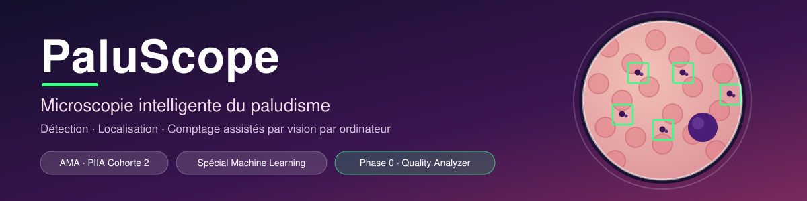

<p align="center">
  
</p>

<p align="center">
  
  
  
  
</p>

> **Prototype de recherche et de formation.** PaluScope n'est pas un dispositif médical : il ne pose aucun
> diagnostic clinique et ne prescrit aucun traitement. Il assiste la lecture de frottis sanguins par un humain.

**Chaîne de traitement :** Image → Contrôle qualité → Candidats → Classification / localisation → Comptage → Revue humaine
## Phase actuelle : Phase 0 : Vision classique et mathématiques
- Période : 26 septembre 2026 - début octobre 2026
- Livrable : **V0 : Blood Smear Quality Analyzer**
- Hors périmètre : CNN, Transfer Learning, ML supervisé, application finale

# Données

## Dataset de départ : Microscopy Malaria Dataset - split `plasmodium-phonecamera`
- Auteurs : J. Quinn, R. Nakasi, P. K. B. Mugagga, P. Byanyima, W. Lubega, A. Andama
  (Makerere University AI Lab, Ouganda), 2016
- Page officielle : https://air.ug/microscopy/
- Téléchargement : http://air.ug/downloads/plasmodium-phonecamera.zip
- Licence : CC0 1.0
- Contenu : frottis sanguins épais (Field stain), ×1000, photographiés au smartphone
  via un adaptateur de microscope ; 1182 images, 7245 plasmodiums annotés
  (boîtes englobantes)
- Citation : Quinn et al., Microscopy Malaria Dataset, 2016, https://air.ug/microscopy/

## Organisation
- `raw/` : dataset brut, NON versionné. Dézipper ici le fichier téléchargé.
- `processed/` : données transformées, NON versionnées.
- `samples/` : petit jeu d'images d'exemple pour les tests locaux (versionné).

## À compléter après exploration
Format des annotations, dimensions des images, anomalies observées.

## Équipe
| Membre | Responsabilité principale |
|---|---|
| Narcisse ATTIOU | Coordination, exploration des données, intégration V0 |
| Juste AGBO | Quality Analyzer (`src/quality/`) |
| Aichatou TRAORE| Candidate Detection (`src/preprocessing/`, `src/candidates/`) |

## Installation
```bash
git clone <URL_DU_DEPOT>
cd PaluScope
python -m venv .venv
source .venv/bin/activate        # Windows : .venv\Scripts\activate
pip install -r requirements.txt
```

## Structure
```
data/        raw/ (non versionné) · processed/ · samples/ (petit jeu de test)
notebooks/   phase_0/ — exploration et expérimentation
src/         quality/ · preprocessing/ · candidates/ — code réutilisable
tests/       tests unitaires
reports/     phase_0/ — notes et rapport
app/         réservé à PaluScope Studio (phases ultérieures)
docs/        journal des décisions, conventions
```

## Données
Les gros fichiers de dataset ne sont **pas** poussés sur GitHub. Voir `data/README.md`
pour savoir où les télécharger et où les placer.

## Règles de travail
Voir [CONTRIBUTING.md](CONTRIBUTING.md) et [docs/decisions.md](docs/decisions.md).
