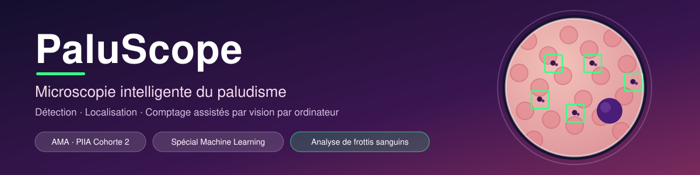

<p align="center">
  
</p>

<p align="center">
  
  
  
  
  
</p>

> **Prototype de recherche et de formation.** PaluScope n'est pas un dispositif médical : il ne pose aucun diagnostic clinique et ne prescrit aucun traitement. Il assiste la lecture de frottis sanguins par un humain.

PaluScope est un prototype de recherche et d'assistance qui analyse des images de frottis sanguins : il contrôle leur
qualité, repère les parasites suspects, les compte, et mesure la robustesse du système quand on change de microscope,
de téléphone, de laboratoire ou de jeu de données.

**Chaîne de traitement :** Image → Contrôle qualité → Candidats → Classification / localisation → Comptage → Revue humaine

## Phase actuelle : Phase 1, jeu de données, candidats et variables

- Période : novembre 2026
- Livrable : table de candidats étiquetés avec 425 variables, découpage sans fuite entre groupes de quasi-doublons, détecteur de candidats gelé
- Hors périmètre : CNN, Transfer Learning, application finale
- Phase précédente : Phase 0, **V0 · Blood Smear Quality Analyzer** (ci-dessous)

### Ce que contient la Phase 1

| Brique | Rôle | Code |
|---|---|---|
| Registre et découpage | 1 182 images, groupes de quasi-doublons (pHash), `split_v1` 70/15/15 | `src/data/`, `data/registry/`, `data/splits/` |
| Détecteur gelé | Paramètres figés, rappel des boîtes annotées 0,991 (train) et 0,994 (val) | `configs/candidates_v1.json` |
| Étiquetage et patches | Candidat positif si son centre tombe dans une boîte annotée ; patches 48×48 | `src/data/labeling.py`, `patches.py` |
| Variables | geo_, col_, grd_, tex_, hog_ et qual_ (425 au total) | `src/features/`, `src/preprocessing/normalize.py` |
| Table de candidats | 21 611 candidats, 0 NaN, contrôles anti-fuite | `scripts/build_dataset.py` |

Bilan chiffré et limites : [docs/phase1_synthese.md](docs/phase1_synthese.md). Registre des données : [docs/dataset_registry.md](docs/dataset_registry.md).

```bash
python scripts/build_registry.py --threshold 8
python scripts/make_split.py
python scripts/build_dataset.py
```

## Phase 0, vision classique et mathématiques

- Période : 26 septembre 2026 - début octobre 2026
- Livrable : **V0 · Blood Smear Quality Analyzer**
- Hors périmètre : CNN, Transfer Learning, ML supervisé, application finale

### Ce que contient la V0

| Brique | Rôle | Code |
|---|---|---|
| Contrôle qualité | Netteté, luminosité, contraste, saturation, couleur, et alertes (flou, trop sombre, surexposé…) | `src/quality/` |
| Régions candidates | Taches sombres plausibles (black-hat, seuillage, morphologie, composantes connexes) avec aire, périmètre, circularité | `src/candidates/` |
| Démo | Application Streamlit qui enchaîne les deux briques | `app/streamlit_app.py` |

## Démo Streamlit

```bash
streamlit run app/streamlit_app.py
```

L'application permet de choisir un échantillon du dépôt (`data/samples/`) ou d'importer une image JPEG/PNG, puis :

1. d'afficher les métriques de qualité et les alertes ;
2. de détecter les régions candidates, de régler la détection, et de les comparer aux annotations du jeu de données ;
3. de télécharger les candidats (CSV) et l'image annotée (PNG).

<!-- Quand la capture sera prête :  -->

## Utiliser le code

```python
from src.quality.analyzer import analyze_image
from src.candidates.extract import extract_candidates

quality = analyze_image("data/samples/plasmodium-phone-0001.jpg")
print(quality["flags"])            # blurry, low_contrast, too_dark, too_bright, overexposed, dark_borders

# extract_candidates attend un tableau RGB uint8 (H, W, 3) : cv2.imread donne du BGR, il faut convertir
candidates = extract_candidates(image_rgb)
print(candidates[0])               # {"id", "bbox": (x, y, w, h), "area", "perimeter", "circularity"}
```

Les formats d'échange entre modules sont décrits dans [docs/conventions.md](docs/conventions.md).

## Installation

```bash
git clone https://github.com/ATTIOU19/PaluScope.git
cd PaluScope
python -m venv .venv
source .venv/bin/activate        # Windows : .venv\Scripts\activate
pip install -r requirements.txt
```

### Tests

```bash
python -m pytest
```

## Données

### Dataset de départ : Microscopy Malaria Dataset, split `plasmodium-phonecamera`

- Auteurs : J. Quinn, R. Nakasi, P. K. B. Mugagga, P. Byanyima, W. Lubega, A. Andama
  (Makerere University AI Lab, Ouganda), 2016
- Page officielle : https://air.ug/microscopy/
- Téléchargement : http://air.ug/downloads/plasmodium-phonecamera.zip
- Licence : non précisée sur la page officielle ; CC0 1.0 selon le site tiers Dataset Ninja, à confirmer auprès des auteurs (voir `docs/dataset_registry.md`)
- Contenu : frottis sanguins épais (coloration de Field), ×1000, photographiés au smartphone via un adaptateur de
  microscope ; 1 182 images (750 × 750 px) avec annotations Pascal VOC. Les auteurs annoncent 7 245 plasmodiums
  annotés ; les fichiers XML contiennent 7 628 boîtes (d'environ 40 × 40 px).
- Citation : Quinn et al., Microscopy Malaria Dataset, 2016, https://air.ug/microscopy/

### Organisation

- `data/raw/` : dataset brut, **non versionné**. Dézipper ici le fichier téléchargé.
- `data/processed/` : données transformées, **non versionnées**.
- `data/samples/` : petit jeu d'images d'exemple (versionné), utilisé par les tests et la démo.

Les gros fichiers ne sont **pas** poussés sur GitHub. Voir `data/README.md` pour où les télécharger et où les placer.

## Structure

```
app/         démo Streamlit de la Phase 0 (PaluScope Studio viendra dans une phase ultérieure)
configs/     paramètres figés (détecteur de candidats, variables)
data/        raw/ (non versionné) · registry/ · splits/ · processed/ (non versionné) · samples/
docs/        décisions, conventions, registre des données, note de synthèse Phase 1
notebooks/   phase_0/ : exploration, qualité, candidats · phase_1/ : exploration des variables
reports/     phase_0/ et phase_1/ : notes, rapports, résumés chiffrés
scripts/     construction du registre, du découpage et de la table de candidats
src/         quality/ · preprocessing/ · candidates/ · data/ · features/
tests/       tests unitaires et test de fumée de l'application
```

## Équipe

| Membre | Responsabilité Phase 0 | Répartition Phase 1 |
|---|---|---|
| Narcisse ATTIOU | Coordination, exploration des données, intégration V0 | **P1-A - Registre et découpage** : registre de données, métadonnées des images, groupes de quasi-doublons et `split_v1` (`docs/dataset_registry.md`, `data/registry/`, `data/splits/split_v1.csv`, `src/data/`).<br>**P1-D - Assemblage** : `build_dataset.py`, contrôles anti-fuite et qualité du jeu, notebook de synthèse et documentation (`scripts/build_dataset.py`, `src/features/builder.py`, `notebooks/phase_1/`). |
| Juste AGBO | Quality Analyzer (`src/quality/`) | **P1-C - Normalisation et variables** : normalisation couleur, variables couleur, gradients, texture, HOG et variables de contexte `qual_` (`src/preprocessing/normalize.py`, `src/features/color.py`, `src/features/texture.py`, `src/features/hog.py`). |
| Aichatou TRAORE | Candidate Detection (`src/preprocessing/`, `src/candidates/`) | **P1-B - Étiquetage et patches** : évaluation et gel du détecteur (`R_cand`), règle d’étiquetage, extraction des patches et variables géométriques (`configs/candidates_v1.json`, `src/features/geometry.py`, `src/data/labeling.py`, `src/data/patches.py`). |

Programme : Académie des Mathématiques Appliquées (AMA), PIIA Cohorte 2, spécial Machine Learning.

## Règles de travail

Voir [CONTRIBUTING.md](CONTRIBUTING.md) et [docs/decisions.md](docs/decisions.md).